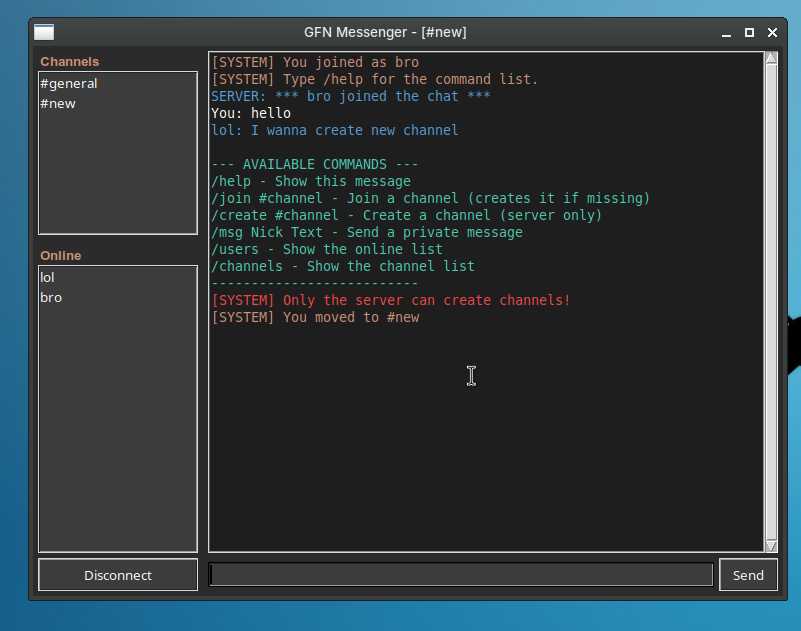

[README.md](https://github.com/user-attachments/files/35143403/README.md)
# GFN Messenger

A lightweight, self-hosted chat for local networks — server and client in a single Python file, with a Tkinter interface. Works on PC and on Android (via PyDroid 3).

Licensed under the GNU General Public License v3.0.

## Features

- **Server & client in one app** — launch it as a server or connect as a client, no separate files needed
- **SSL encryption** — all traffic is wrapped in TLS; a self-signed certificate is generated automatically on first run
- **Channels** — everyone starts in `#general`; the server can create more channels with `/create`
- **Private messages** — send direct messages to any user with `/msg`
- **Keep-alive ping** — the client pings the server every 30 seconds so idle connections don't drop
- **Reconnect button** — if the connection is lost, reconnect with the same nick, IP and port in one click
- **Disconnect button** — leaves the session and returns to the main login screen
- **JSON-over-TCP protocol** — newline-delimited JSON packets with length limits (4 KB per message, 1 MB buffer)

## Requirements

- Python 3 (with tkinter; included in most distributions)
- `cryptography` — only needed to generate SSL certificates on the server side:

  ```
  pip install cryptography
  ```

## Usage

1. Run the script:

   ```
   python CHATGFN_fixed.py
   ```

2. Enter a nickname (up to 24 characters, no spaces) and a port (default `7777`).
3. On the host machine, click **Start Server**.
4. On other machines (or phones), enter the server's IP and click **Connect (Client)**.
5. Chat away.



### Commands

| Command | Description |
| --- | --- |
| `/help` | Show the command list |
| `/join #channel` | Switch to a channel (creates it on the fly for clients) |
| `/create #channel` | Create a channel (server only) |
| `/msg Nick Text` | Send a private message |
| `/users` | List online users |
| `/channels` | List channels |

Tip: double-click a user in the **Online** list to start a private message, or double-click a channel to join it.

### On Android (PyDroid 3)

1. Install [PyDroid 3](https://play.google.com/store/apps/details?id=ru.iiec.pydroid3) from Google Play.
2. Open the script in PyDroid 3 and run it — the Tkinter interface works there too.
3. Connect as a client to a PC running the server (make sure the PC firewall allows the port).

## Security notes

- The self-signed certificate is generated locally, so the client uses `CERT_NONE` verification mode. This is fine for a trusted local network, but do **not** expose the server to the internet without additional hardening.
- Messages are limited to 4000 characters; the receive buffer is capped at 1 MB.

## License

This project is licensed under the [GNU General Public License v3.0](https://www.gnu.org/licenses/gpl-3.0.en.html).
